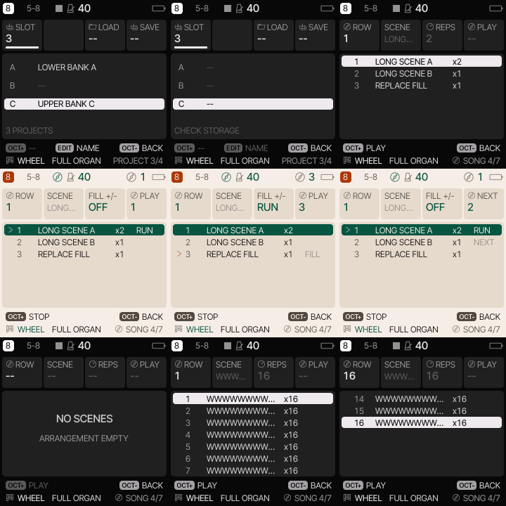

# Native project and arrangement rendering evidence

Functional source: `781ab9a857160a09f122b2e913ef151f2547ef0f`, based on merged main `984f4802ba3e284cd9cd08f4c3606d363877eb49`.

The actual adopted native SONG page previously rendered historical four-project instructions beneath its native cards. Its fixed `PLAYROW` label also ellipsised, and long scene names were treated as fixed values. The renderer now shows native scene rows, repeats, playing/queued/fill status, a fitting `PLAY` label and explicitly designated user names. Adopted empty arrangements show no invented row or repeat and never fall through to historical instructions. The four-track renderer remains conditional historical code.

Optimized and inherited DSP ASan/UBSan runs each passed **35,427 checks over 3,361 frames**. The fixture decodes/adopts actual native wire state, seeds a sparse virtual NOR catalog through the real writer, prepares real source references, and drives actual sequencer/fill/queue transitions. Rendering makes no storage access, preserves complete native arrangement/name data, and respects actual asynchronous LCD and exclusive migration workspace ownership. Layout lint remains strict for fixed labels; only designated user text may ellipsise.

The regular matrix covers nine states, all ten palettes, both styles, both sizes and all eight selected tracks. Additional actual adopted empty and maximum 16-row/16-repeat arrangements use wide 12-character names, first/last/out-of-range cursors, both banks and a seven-row viewport. Nonforced queued-row and actual boundary changes independently exercise graph cache invalidation. This is bounded host coverage, not every possible arrangement or a device gesture test.

The exact parent `ui_draw.c` and `ui_graph.c`, substituted into the same final fixture, failed with 16,252 assertions/layout findings. The new read-only adopted-state helper is unused by those parent renderer files. The complete negative log is private; its SHA-256 and an excerpt are retained here. Earlier harness failures (invalid level seed, diagnostic symbol names, clock/start request ordering, and an overbroad empty-card number assertion) remain private and hashed separately.

The image sheet shows ready/error catalog, stopped/running/fill/queued arrangements, empty state and maximum first/last viewports. These are actual source renderer pixels, visually inspected locally; they are not device photographs.

Fresh pinned four/eight target builds passed at `3be66755ed73dfaa92e15254cc5f942537ddecdb`. After the final native-only empty-value refinement, the eight-track target was freshly rebuilt at the functional source above: 480,012 bytes, RAM 95,812 bytes, pool 335,240 bytes. The four-track report is explicitly the prior source, not a fresh final-source build; its 447,928-byte image has SHA-256 `3ced057d74785ecd0cc2ccc8f274a1c9e94caa4a6b1203c846014a890d4720fc`, unchanged from the integrated default four-track build. It differs from the reconciled pristine audited v1.1.5 image at source `276f72a4e6ea8a12499a7a6819aadf3165126755`: 447,576 bytes, SHA-256 `d05d7de131b31956b2c154a096a78cd853c649be96976b02d026f393886b3524`. The previously documented upstream wake fixes remain integrated. The six protected **historical development reference** artifact/golden/cost-input hashes (including the later `b69e…` development image) and 29 generated input hashes remain unchanged. Inherited target-report labels `audited_v115_hash_matches` and `six_baseline_hashes_unchanged` refer to that historical local reference set; they do not reclassify `b69e…` as pristine upstream. No golden suite pass is borrowed: this topic ran focused checks, not a duplicate local full suite.

The native static IRQ cost remains 55,487/37,502 and USB48 remains 555/504 (above the original 554.4 limit); both fail. ROOM 233/218 and SPRING 135/126 pass their original 10% limits. No thresholds changed. A pre-existing volatile-qualifier warning remains in the target log. No physical deadline, display palette, USB/TRS device, flash, release or installation qualification is claimed. Issues #10/#15 remain open for their broader and physical gates.

The sanitizer run retains the existing actual DSP exclusions: signed integer overflow, shifts, bounds, object size and pointer overflow. It is not a claim of strict sanitizer coverage. Build logs, source/input pins and raw result scopes are included; binaries, disassembly, vendor firmware and private backups are excluded.
